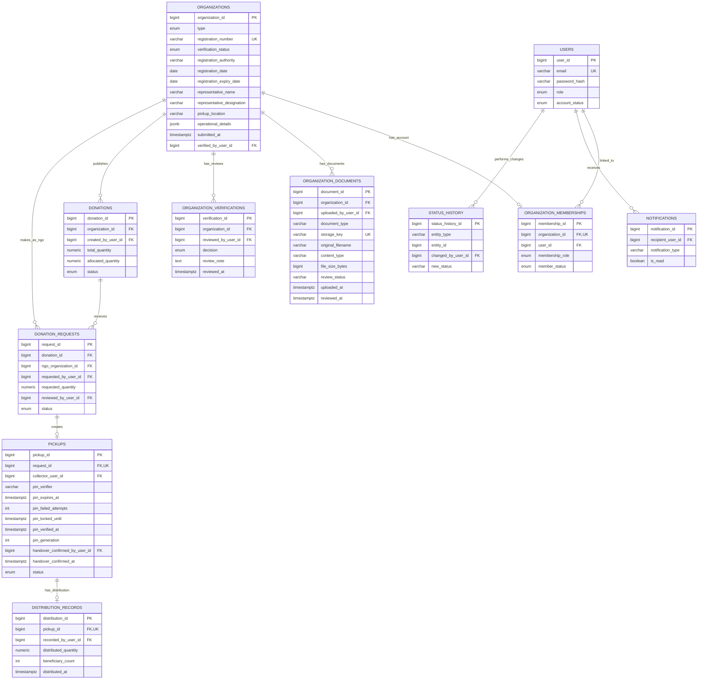

# Meal Connect MVP — Database ER Diagram

**Jira:** MEAL-213
**Schema revision:** `66af9d4181e5` (parent: `d99d12936307`)
**Database:** PostgreSQL
**Application tables:** 11 (`alembic_version` is separate)

## Entity relationships

## Cardinality and integrity rules

- **One authorized account per organization:** `organization_memberships.organization_id` has the unique constraint `uq_membership_single_account_per_org`. An organization can have **at most one** membership record. Organization signup must create the organization and its membership atomically.
- **Multiple organizations per user:** the current schema does *not* prohibit a user from being linked to several organizations. Application-level account policy must be enforced separately if this is undesired.
- **Verification:** documents and Admin review history are separate. `organizations.verification_status` controls approval; `submitted_at` distinguishes an unsubmitted draft from a submitted application within the agreed workflow.
- **Donation request:** a donation can have several NGO requests. Each request has one requested quantity; approval or rejection of that full quantity is enforced by backend service logic.
- **Allocation:** `donations.allocated_quantity` is constrained to `0 <= allocated_quantity <= total_quantity`. Concurrent approval must use a safe transaction/locking strategy.
- **Pickup:** `pickups.request_id` is unique, so a donation request can have at most one pickup. The PIN verifier, expiry, attempt limit, lock state and confirmation timestamps support the approved workflow but do not implement it by themselves.
- **Handover vs distribution:** PIN verification is separate from Restaurant handover confirmation (`handover_confirmed_at`, pickup status `picked_up`). NGO distribution is subsequently recorded in `distribution_records`; `distribution_records.pickup_id` is unique.
- **Legacy field:** `pickups.collector_user_id` still exists in this migration for compatibility, but the MVP pickup representative does not have a platform login. The field must not be used by the new workflow.
- **Status history:** `status_history.entity_type` + `entity_id` is a generic reference, **not** a database-enforced foreign key to each business table.
- **Private documents:** `organization_documents.storage_key` is unique and references private storage. The documents are not stored as database blobs; file access must be authorized by backend APIs.

## Additional foreign keys not drawn as diagram lines

The diagram emphasizes the main business flow. These columns also refer to `users.user_id`: `organizations.verified_by_user_id`, `organization_documents.uploaded_by_user_id`, `organization_verifications.reviewed_by_user_id`, `donations.created_by_user_id`, `donation_requests.requested_by_user_id`, `donation_requests.reviewed_by_user_id`, `pickups.collector_user_id` (legacy), `pickups.handover_confirmed_by_user_id`, and `distribution_records.recorded_by_user_id`. The primary workflow relationships and these auxiliary foreign keys together describe the implementation.

## Scope and implementation note

This is a **selected-column physical ER overview**, not a full inventory of every database column. It documents the migrated schema, not proof that registration, verification, PIN generation, authorization, or food-distribution services are already implemented. The `alembic_version` table is managed by Alembic and is not one of the 11 application tables.
